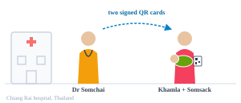
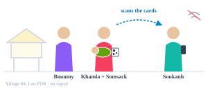
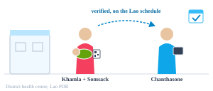
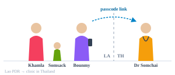

# SMART Trust demonstrator

One baby · two countries · one year

Somsack is born in Thailand and grows up in Lao PDR. A year later, a Thai doctor sees every vaccine he has ever had, and no record is copied across the border.

This guide is that story, the <a style="color:#7dd3fc" href="https://fredhersch.github.io/vaxlink/">VaxLink walkthrough</a>, written down as a WHO SMART Guidelines digital adaptation kit (L2) and a FHIR implementation guide (L3). It is built on the SMART Trust HCERT libraries and WHO GDHCN.

<a href="https://litlfred.github.io/vaxlink/" style="display:inline-block;background:#0ea5e9;color:#fff;font-weight:600;padding:8px 14px;border-radius:8px;text-decoration:none;margin:0 8px 8px 0">Open the VaxLink walkthrough</a>
<a href="journeys.html" style="display:inline-block;background:rgba(255,255,255,.12);color:#fff;font-weight:600;padding:8px 14px;border-radius:8px;text-decoration:none;margin:0 8px 8px 0">Read the journeys</a>
<a href="vaxlink-examples.html" style="display:inline-block;background:rgba(255,255,255,.12);color:#fff;font-weight:600;padding:8px 14px;border-radius:8px;text-decoration:none;margin:0 0 8px">See the FHIR examples</a>

## Four moments that matter

Each moment is one business process (BPMN), played by fictional people. Each
one is linked to the user scenario, the process and the FHIR records it
creates.

1. Born abroad

Birth day · Chiang Rai, Thailand · J1

A Lao baby gets his first vaccines in Thailand. The hospital signs each dose as a Digital Vaccination Certificate, and the family leaves with two paper QR cards.

<a href="journeys.html">Scenario</a> · <a href="business-processes.html#j1-issue-the-newborns-birth-dose-dvcs-in-country-a">Process</a> · <a href="artifact/StructureDefinition-TrustDemoThImmunization.html">Thai profile</a>

2. Found at home

3 weeks later · Village 04, Lao PDR · J2

A health worker registers him offline and reads the cards. She records them as "reported, not yet verified" and refers him to the clinic.

<a href="journeys.html">Scenario</a> · <a href="business-processes.html#j2-discover-and-refer-an-unregistered-infant-in-country-b">Process</a> · <a href="artifact/StructureDefinition-TrustDemoLaoReportedImmunization.html">Lao profile</a>

3. Made official

4 weeks later · district health centre, Lao PDR · J3

A nurse checks the signatures against the GDHCN trust list, offline. She maps the Thai vaccine codes to the Lao schedule and books the 6-week doses.

<a href="journeys.html">Scenario</a> · <a href="business-processes.html#j3-verify-import-and-schedule-at-the-home-clinic">Process</a> · <a href="artifact/StructureDefinition-TrustDemoLaoImmunization.html">Lao profile</a>

4. Crossing back

12 months later · Lao PDR → Thailand · J4.0, J4.1

The family shares his whole record with a Thai doctor through a Verifiable Health Link on Dad's phone. Every access is logged back home.

<a href="journeys.html">Scenario</a> · <a href="business-processes.html#j41-read-a-family-members-records-at-the-point-of-care-abroad">Process</a> · <a href="artifact/StructureDefinition-TrustDemoLaoVhlAccess.html">Lao profile</a>

## What is in this guide

| | What | Where |
|---|---|---|
| **People** | Five fictional adults and a baby; the generic personas and system actors who play each process lane | [Personas](personas.html), [system actors](system-actors.html) |
| **Journeys** | The story moment by moment, with the user scenarios and what each person needs | [Journeys J1–J4](journeys.html), [user scenarios](scenarios.html) |
| **Workflows** | One BPMN process per journey: every lane a role, every task a skill | [Business processes](business-processes.html) |
| **Requirements** | Where the journeys' requirements are defined, in smart-trust-tools | [Functional requirements](functional-requirements.html) |
| **Thai profiles** | The birth hospital's patient and dose (the source of each DVC), and the record a Thai clinic keeps when it reads a VHL | [Country profiles](vaxlink-examples.html#country-profiles) |
| **Lao profiles** | The child and household the CHW registers, reported and verified doses, the referral, DVC verification, and the access log | [Country profiles](vaxlink-examples.html#country-profiles) |
| **Terminology and logic** | Vaccine products, the Lao schedule codes, the ConceptMap between them, and the infant schedule as a PlanDefinition | [VaxLink examples](vaxlink-examples.html) |
| **Examples** | Every screen and payload of the VaxLink walkthrough as a FHIR example, Thai and Lao | [VaxLink examples](vaxlink-examples.html) |
{: .grid }

## How trust works here

Thailand and Lao PDR never connect to each other. Both build on **WHO GDHCN**.
Thailand publishes the key it signs certificates with, and Lao PDR caches the
trust list, so its clinics can verify a Thai card with no signal. A year later
the same trust list lets a Thai clinic verify the Lao VHL. Data crosses the
border in only two ways: as a signed QR card the family carries, or as a link
the family chooses to share. The [VaxLink walkthrough's "How it works"
view](https://litlfred.github.io/vaxlink/#/how) lays out both countries'
components on the [DPI-H reference
architecture](https://litlfred.github.io/smart-ra/en/dpi-h-ra/index.html), with
GDHCN as the foundation.

The journeys run the HCERT and VHL libraries of
[smart-trust-tools](https://litlfred.github.io/smart-trust-tools/) against
[WHO SMART Trust](https://smart.who.int/trust) and [WHO SMART Trust
PHW](https://smart.who.int/trust-phw).

## The project

The [plan](plan.html), the [app-platform proposal](proposals/app-platform.html)
and the [dependency register](dependencies.html). Source:
[litlfred/smart-trust-demo](https://github.com/litlfred/smart-trust-demo).

Every person and record here is fictional, and every key is a test key. This
guide is a demonstrator, not WHO guidance.
